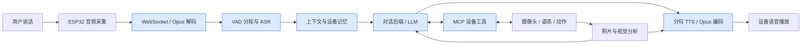

# Deskbot 服务端语音与对话模块阶段工作总结

展示日期：2026-10-16

依据：仓库 2026-08-07 至 2026-10-13 的提交、当前实现、已有验收记录，以及历史聊天《复刻 ASR 和 TTS 模型对比测试》中的正式实验输出。本文按 BE-VOICE 职责整理，不将其他成员的固件驱动、独立视觉模块和音乐网关实现计为个人独立成果。本次整理未重新执行模型实验或硬件验收。

## 1. 一句话概括

我负责 Deskbot 的服务端语音与对话模块，完成了语音模型对比实验、语音对话链路、设备记忆和工具接入，并通过联调界面、运行诊断和故障修复支持机器人实机交互。

## 2. 可以放入 PPT 的主要工作

| 工作方向 | 已完成内容 | 对项目的价值 |
| --- | --- | --- |
| 模型对比与选型 | 在 Linux + Conda 环境复刻 ASR/TTS 对比实验，比较 SenseVoiceSmall 与 Fun-ASR-Nano-2512、EdgeTTS 与 Qwen3-TTS 0.6B，记录加载、推理、首音频、RTF 和资源指标 | 为低延迟桌宠语音方案提供实测依据，明确本地与云端方案的取舍 |
| 语音服务基础链路 | 使用 Python 实现兼容小智 WebSocket v1 的语音服务，接入 Silero VAD、SenseVoice ASR、OpenAI 兼容 LLM、Edge TTS 和 Opus 编解码 | 让设备完成“听懂一句话—生成回答—播放语音”的交互闭环 |
| 连续对话与播放体验 | 自动分轮、回复后恢复监听、按句合成、文本与语音任务并行；实机音频按 60 ms 帧节奏下发；浏览器支持说话打断 | 减少反复手动操作，降低长回复音频集中下发造成的播放问题 |
| 对话记忆与模块接口 | SQLite 持久化、按设备隔离、近期上下文、历史摘要及简单相关历史检索；抽象 Provider 和 DialogueBackend | 支持跨轮对话和历史恢复，为替换模型、接入 Agent 保留清晰接口 |
| 设备工具与视觉对话集成 | 接入 MCP 初始化、工具发现和调用，将摄像头、姿态读取及运动工具接入对话；照片上传后调用视觉模型并播报结果 | 让语言请求能够触发设备能力，并返回实际执行或观察结果 |
| 联调与运行支持 | 浏览器文字/录音/WAV 测试、设备状态与历史查看、分阶段耗时、日志导出、模型测速、桌面启动/停止入口及文档 | 便于团队独立验证各阶段，缩短定位问题和准备演示的时间 |
| 稳定性修复 | 服务就绪检查、同设备旧会话替换、超时与取消处理、空回复修复、本地命令 TTS 接口、Edge TTS 403 故障修复 | 提高服务恢复能力，解决会直接影响展示的无声回复等问题 |

核心数据流：

```text
设备语音 → Opus 解码 → VAD 分轮 → SenseVoice 识别
         → 设备记忆与上下文 → 大模型 / 设备工具调用
         → 按句语音合成 → Opus 编码 → 设备播放
```

## 3. 阶段进展

| 时间 | 阶段成果 |
| --- | --- |
| 8 月 7 日 | 提交本地语音服务器初版，建立语音链路、设备协议、记忆和测试基础 |
| 9 月上旬 | 完成 ASR/TTS 对比实验的 Linux 复刻；先做 CPU 测试，再完成 CUDA 正式测试及 EdgeTTS 网络排查，保留统计结果和试听音频 |
| 9 月 22—24 日 | 完成真实模型联调；增加浏览器持续对话、VAD 打断、摄像头工具和视觉问答 |
| 10 月 2 日 | 增加多设备会话监控、历史查看、音频定速下发；完善实机 MCP 工具循环、照片上传分析、诊断和启动入口 |
| 10 月 11 日 | 完善就绪检查、重连处理、记忆保留、动作取消边界及本地 TTS 接口，修复自然语言运动指令和空回复问题 |
| 10 月 13 日 | 修复 Edge TTS 握手 403；协同完成摄像头工具缺失问题的定位及固件更新后的语音视觉联调 |

## 4. 展示时值得讲清楚的技术问题

### 让回复生成与播放衔接起来

LLM 产生的文字按句进入队列，语音合成与后续文字接收可以并行。Edge TTS 音频边接收边转码，实机 Opus 按帧时长发送，避免长回复一次性占满播放队列。打断时取消旧轮并回收转码资源。

这属于分句输出和音频流式处理；ASR 仍在一轮语音结束后识别，不能表述为全链路流式 ASR。

### 让对话真正调用设备

服务端读取当前设备的 MCP 工具清单，将模型请求转发给对应会话，接收工具执行结果后形成回复。对于明确的观察请求，可以直接触发拍照并播报视觉描述。浏览器相机和实机相机分别绑定各自会话。

这里的个人职责应表述为“语音侧工具编排、协议接入和跨模块联调”；相机驱动、底盘驱动和独立视觉模块仍按团队分工归属。

### 把“没有声音”定位到具体环节

增加 ASR、首段文字、首段语音等诊断信息及独立检查脚本。10 月 13 日的问题定位到 Edge TTS 旧端点握手返回 403，更新调用端点后在线语音恢复，避免将问题误判为识别或语言模型故障。

## 5. 已有验证依据

- **自动化回归：**10 月 11 日记录为 342 项 Python、16 项浏览器逻辑和 7 项启动器测试通过。这些是已有记录，不是本次重新跑出的结果。
- **真实语音链路：**9 月 23 日记录了连续两轮真实 ASR → GLM → Edge TTS 测试；浏览器麦克风持续运行超过 100 秒，多轮回复后能够恢复监听。
- **浏览器自动打断：**9 月 24 日使用录音实时输入，第二段话音开始约 362 ms 后打断旧回复，随后完成新一轮识别和回复。该数据是单次观测，不是固定时延或扬声器回声验收。
- **语音恢复：**10 月 13 日在线 LLM/TTS 回合状态为 success，产出约 2.58 秒音频，并有用户确认。2.58 秒指音频长度，不是响应延迟。
- **实机视觉联动：**10 月 13 日设备上报 10 个 MCP 工具，包含拍照；拍照调用约 1.18 秒，首段音频约 7.61 秒，用户确认正确识别并语音回答。该轮最终状态为 cancelled，因此应描述为“拍照、识别与语音输出得到现场确认”，不宜写成整轮无异常完成。

## 6. 模型对比实验与选型依据（补充找回）

### 实验工作

历史聊天《复刻 ASR 和 TTS 模型对比测试》（聊天 ID：`01a082e5-7ba8-75b0-9232-130f86cbcd8c`）保留了从结果 JSON 读取的输出及最终交接报告。实验原本位于另一个 xiaozhi 仓库，不在 Deskbot 当前目录，所以首次梳理遗漏了这部分。

- 在 Linux 的 Conda `test` 环境准备模型与依赖，建立独立的 `voice_benchmark.py`、运行说明及依赖清单。
- ASR 比较 SenseVoiceSmall 与 Fun-ASR-Nano-2512，样本覆盖中文、英文、日文、韩文和粤语。
- TTS 比较 EdgeTTS 与 Qwen3-TTS-12Hz-0.6B-CustomVoice，覆盖短句、桌宠对话、中英技术文本、数字及长文本。
- 正式实验每项重复 5 次，预热不计入统计；记录加载时间、RSS、GPU 显存、延迟统计和 RTF，输出 JSON、CSV 及 50 个试听音频（25 个 EdgeTTS MP3、25 个 Qwen3-TTS WAV）。
- 先完成 CPU 实验，随后在可访问 CUDA 和网络的主机环境完成正式实验；下面使用最终 CUDA 批次的本地模型结果，EdgeTTS 为云端调用。

### ASR 正式结果

| 模型 | 加载时间 | 峰值 GPU allocated | 各样本推理中位数范围 | 各样本 RTF 中位数范围 |
| --- | ---: | ---: | ---: | ---: |
| SenseVoiceSmall | 5.990 秒 | 939.2 MiB | 25–35 ms | 0.0048–0.0055 |
| Fun-ASR-Nano-2512 | 21.464 秒 | 3394.0 MiB | 183–379 ms | 0.0326–0.0816 |

在这批样本和运行环境下，SenseVoiceSmall 推理更快、显存占用更低，支持将其作为实时桌宠的 ASR 方案。RTF 是处理时间除以音频时长，越小表示处理越快。这些推理耗时不包含用户说话、VAD 等待和完整语音链路。

输出检查还发现 Fun-ASR-Nano 的韩语样本转写异常；SenseVoice 的英文样本也存在词语差异。实验未提供系统性的 WER/CER 评估，不能据此宣称某模型在所有语言上的准确率更高。

### TTS 正式结果

| 模型 / 本次接入方式 | 各文本首音频中位数范围 | 各文本总生成时间中位数范围 | RTF 中位数范围 |
| --- | ---: | ---: | ---: |
| EdgeTTS / 云端流式 | 1.10–1.22 秒 | 1.48–1.84 秒 | 0.098–0.683 |
| Qwen3-TTS 0.6B / GPU 整段生成 | 2.08–18.59 秒 | 2.08–18.59 秒 | 0.814–1.087 |

这批测试支持当前优先使用 EdgeTTS 以降低首音频等待时间，同时保留本地 TTS 的后续优化方向。Qwen3-TTS 本次适配器调用完整 waveform 生成接口，首音频时间因此等于总生成时间；这个结果不能解释为 Qwen3-TTS 模型本身不支持流式，也不是完全同等接口下的能力排名。测试没有给出正式的自然度、情绪表现或音色一致性评分。

### 工程问题处理与记录状态

实验期间还定位并处理了依赖兼容、SoX 音频工具和 EdgeTTS 网络访问问题。9 月实验中的 EdgeTTS 失败来自受限执行环境的 DNS/网络访问，恢复主机网络访问后完成正式测试；这与 10 月 13 日旧合成端点返回 403 是两次不同故障。

原路径为 `/home/yyy/desktop/study/xiaozhi/xiaozhi-esp32-server/main/xiaozhi-server/benchmark_results/`，此次未在当前已查目录中找到原始 JSON/CSV；上述数据来自历史聊天保存的实际读取输出，不是本次复测。交接记录说明模型和结果被 Git 忽略，没有提交到仓库。

## 7. 明天可直接使用的口头稿

我主要负责 Deskbot 的服务端语音和对话部分，目标是把设备采集到的语音，转成机器人能够理解、回应和执行的交互。

在模型选型方面，我完成了 ASR 和 TTS 的对比实验，并在 Linux 环境复刻了测试。识别部分比较 SenseVoiceSmall 和 Fun-ASR-Nano，合成部分比较 EdgeTTS 和 Qwen3-TTS。通过固定样本、预热和重复测试，比较推理延迟、首音频时间、实时率和资源占用，为当前采用 SenseVoiceSmall 与 EdgeTTS 的方案提供了实测依据。

第一，我搭建了完整的语音处理链路。设备通过 WebSocket 上传音频，服务端使用 VAD 判断说话结束，通过 SenseVoice 转成文字，再结合上下文交给大模型，最后通过语音合成和 Opus 编码返回设备播放。

第二，我完善了连续对话和记忆能力。服务端会按设备保存历史消息和摘要，让后续回答能够使用前面的上下文。同时实现了按句生成语音和音频定速发送，并在浏览器测试端实现了自动分轮及说话打断。

第三，我负责把设备能力接入语言交互。通过 MCP，语音服务可以调用设备提供的工具，例如读取姿态、请求运动和拍照。视觉部分重点完成了语音侧的集成，让用户提出观察请求后，机器人能够拍照、取得视觉描述并用语音回答。

此外，我补充了浏览器联调页面、多设备状态查看、耗时诊断、日志和启动工具。最近还修复了 Edge TTS 无法合成的问题，并协同完成了实机摄像头工具的联调。

目前已有真实语音对话和实机视觉语音联动的验证记录。后续重点是降低首段回复等待时间，完善设备端打断，并继续验证长时间运行的稳定性。

## 8. 展示顺序与表述边界

建议展示顺序：普通语音问答 → 同一设备的上下文追问 → 在线设备和耗时界面 → 拍照识别并语音回答。若展示自动说话打断，使用已实现该能力的浏览器持续对话模式。

- 当前常用方案是本地 VAD/ASR 加云端 LLM、视觉模型和 Edge TTS；可自托管服务不等于当前配置完全离线。
- 浏览器已实现回复期间 VAD 打断；原生 ESP32 支持协议取消，但尚未增加同样的回复期间 VAD 自动打断。
- 记忆是按设备隔离的消息、摘要和简单检索，不等于声纹身份识别或完整的长期记忆系统。
- 多连接和设备隔离有服务端测试，不能据此宣称已完成大规模并发或长期运行压测。
- 实机运动、姿态读取等服务端工具接入已经实现；现有记录不足以将每种动作都标为现场验收通过。
- 展示前应确认当前局域网地址、设备连接，以及真实模型和语音输出；此次总结没有改变或重启服务。

## 9. 完整展示方案：10 页、约 10 分钟

建议标题：**Deskbot 服务端语音交互系统：模型评测、系统实现与实机联调**。

整场围绕一个问题展开：如何让桌面机器人听懂用户、结合上下文回答，并调用设备完成交互？按“需求与职责 → 模型选择 → 系统实现 → 实测与展示”的顺序讲。日期和提交时间线可放在备份页，需要说明进度时再展开。

### 第 1 页：我的职责与阶段成果（30 秒）

页面内容只放三组信息：

- 场景：桌面机器人语音交互。
- 职责：服务端语音、对话、记忆、工具接入与联调。
- 交付：模型对比实验、可运行服务、测试与诊断工具。

讲稿：

> 我负责 Deskbot 的服务端语音和对话部分。工作包括语音模型评测、整条语音链路的实现，以及记忆和设备工具的接入。这个阶段的目标是让机器人能够完成连续问答，并把用户的语言请求连接到设备能力。

### 第 2 页：系统架构与我的工作范围（45 秒）

页面使用一张主流程图，以颜色标出服务端实现；视觉服务与固件设备作为协作接口放在旁边。



讲稿：

> 设备负责采集和播放，服务端完成识别、上下文组织、模型调用和语音合成。对需要操作设备的请求，服务端通过 MCP 调用相应工具。我的工作主要集中在图中的服务端链路及跨模块接口。当前运行方案使用本地识别与云端对话、语音合成服务。

补充技术信息放备注：Python 单进程服务；WebSocket v1；设备输入 16 kHz、输出 24 kHz；Provider 与 DialogueBackend 接口支持替换模型和扩展后端。不要把服务端 API 调用描述为自研模型训练。

### 第 3 页：ASR 对比实验与识别方案选择（75 秒）

页面先写方法：**5 种语言样本，预热后每项重复 5 次，最终本地模型使用 CUDA**。随后放第 6 节 ASR 表，重点保留推理延迟和显存两列。

讲稿：

> 为了选择适合实时交互的识别模型，我在 Linux 和 Conda 环境复刻了测试，比较 SenseVoiceSmall 和 Fun-ASR-Nano。测试覆盖五种语言，预热后重复五次，记录加载、推理、资源占用和实时率。在这批样本上，SenseVoice 的推理中位数约 25 到 35 毫秒，峰值显存约 939 MiB；Fun-ASR-Nano 为 183 到 379 毫秒，约 3394 MiB。因此这批性能数据支持当前选择 SenseVoice。准确率还需要扩大样本和正式评估。

视觉建议：使用延迟范围和峰值显存两组图或一个简洁表格。范围是不同样本的中位数范围，不是置信区间；没有逐次原始数据时不画误差棒。

### 第 4 页：TTS 对比与本地、云端方案取舍（60 秒）

页面放第 6 节 TTS 表，以及“短句 / 桌宠对话 / 中英技术词 / 数字 / 长文本”的测试覆盖。脚注注明接口差异。

讲稿：

> 合成部分比较了云端 EdgeTTS 和本地 Qwen3-TTS。Edge 的首音频时间在 1.10 到 1.22 秒之间；Qwen 在当前整段生成接口下为 2.08 到 18.59 秒，随文本长度变化。这给出了当前采用 EdgeTTS 的延迟依据，同时也说明本地方案后续应重点优化流式接入。这里比较的是实际接入方案，不能把接口差异直接解释成模型能力差异。

页底写实验产物：统一脚本、JSON/CSV、50 个试听音频。注明产物来自历史实验记录；不要在没有找回音频的情况下承诺现场播放对比。CosyVoice、IndexTTS 仅曾列为候选，没有本次实测结果，不列为“已完成评测”。

### 第 5 页：从模型调用到连续对话（60 秒）

页面按交互过程展示四项实现：

1. VAD 判断说话结束，触发本轮 ASR。
2. LLM 文本按句进入队列，合成与后续文本接收并行。
3. Edge 音频流式转码，Opus 按 60 ms 节奏发送给实机。
4. 回复完成恢复监听；浏览器支持说话打断并取消旧轮。

讲稿：

> 语音交互还需要处理分轮、等待、播放和取消。我实现了按句合成和音频定速发送，避免长回复集中涌入设备播放队列。浏览器端能在说话时打断旧回复，并继续接收新一句。实机在自动监听模式下会在回复完成后重新进入监听，但回复期间的 VAD 自动打断还没有扩展到原生设备。

### 第 6 页：对话记忆与模型扩展接口（60 秒）

页面分成“上下文组成”和“模块边界”两部分。

- 上下文：系统角色、设备历史摘要、近期消息、简单相关历史、本轮输入。
- 存储：SQLite，按 Device-Id 隔离，保存原始消息与摘要进度。
- 管理：历史查询、追加和清除接口。
- 扩展：ASR/LLM/TTS Provider、DialogueBackend；启动器支持选择 ninfer、Ollama、智谱接入模式。

讲稿：

> 为了让对话能够延续，我把历史消息和摘要保存在 SQLite 中，并按设备隔离。每轮会组织角色、历史和当前问题，提供给模型。同时把语音层与对话后端拆开，使替换模型或接入新的 Agent 后端时，不必重写音频传输逻辑。多种模型入口已经接入启动器，但这与对每个模型完成横向评测是两件事。

### 第 7 页：语言驱动设备工具与视觉反馈（45 秒）

页面展示一条具体请求：

```text
“看看前面有什么”
→ 语音识别与请求路由
→ 当前设备拍照工具
→ 图片上传与视觉分析
→ 语音回答
```

旁边放 MCP 初始化、工具发现、调用与返回三个步骤；运动和姿态作为其他已接入工具类别，不标记为全部实机验收通过。

讲稿：

> 我负责把设备工具接到语言交互中。服务端发现当前设备提供的能力，再把调用发送到正确的会话。对于观察请求，能够拍照、取得视觉描述并播报。这部分已经有实机识别并语音回答的现场记录。我的贡献是语音侧编排、接口接入和联调，相机驱动等按团队分工完成。

### 第 8 页：联调工具与关键故障解决（45 秒）

页面用一张实际测试页截图，标出在线设备、对话记录、分阶段耗时、工具状态；截图需在展示前采集，不使用虚构界面。

讲稿：

> 为了让团队能定位问题，我做了浏览器测试页、设备状态和历史查看、阶段耗时、日志导出及独立测速脚本，也补齐了桌面启动和停止入口。最近一次没有声音的问题，通过分阶段检查定位到 TTS 端点握手返回 403，修复后恢复了在线语音。这些工具让我们能判断问题出在识别、模型、设备调用还是合成。

备注可补充：服务就绪检查、同设备会话替换、超时与任务回收、本地命令 TTS、工具白名单与运动时长限制。无需逐条念实现细节。

### 第 9 页：现场演示与验证证据（90 秒）

演示按下一节执行，页面保留三项证据：

- 真实多轮语音链路已有运行记录。
- 实机拍照、视觉分析和语音输出已有现场确认。
- 10 月 11 日回归记录：342 项 Python、16 项浏览器逻辑、7 项启动器测试通过。

讲稿：

> 接下来展示普通问答、上下文追问和拍照回答。同时可以在测试页看到当前设备、处理阶段和历史记录。自动化测试主要验证协议、会话和数据处理，真实模型与硬件由另行记录的联调来验证。

### 第 10 页：阶段成果与下一步（30 秒）

页面保留三项成果和三项后续工作：

| 已完成 | 下一步 |
| --- | --- |
| 模型评测与语音方案选择依据 | 扩大 ASR 样本，补充准确率与噪声条件评估 |
| 语音、记忆和设备工具接入 | 优化首段音频等待与本地 TTS 接入 |
| 联调界面、诊断与实机验证记录 | 完善设备自动打断，验证长时间运行 |

结束讲稿：

> 这个阶段交付了模型评测依据、服务端交互实现和联调验证工具。下一步会围绕可测量的响应延迟、识别质量和设备持续运行继续完善。

## 10. 现场演示脚本

建议准备 90 秒主线，视回答长度留出机动时间。下面是建议操作和预期观察，本次没有执行演练。

| 顺序 | 操作或说法 | 让观众看到什么 |
| --- | --- | --- |
| 1 | 打开测试页，展示已连接实机 | Device-Id、会话、工具状态，说明设备已连接服务端 |
| 2 | “请用一句话介绍你自己。” | 识别文本、模型回复、真实语音播放，验证基础链路 |
| 3 | “我今天打算学习 Python。”随后问“我刚才说要学什么？” | 同一会话的上下文追问；说明它展示近期上下文，不能单凭这一项证明跨重启持久化 |
| 4 | 在相机前放置一个清晰物体，问“看看前面有什么。” | 拍照工具调用、视觉描述和语音播报 |
| 5 | 指向历史和耗时界面 | 说明服务端保留了交互记录，也能定位各阶段等待 |

浏览器自动打断作为可选加演：切到浏览器持续对话，先请求介绍一个话题，在回复中说“停一下，换个话题”。只有当前扬声器和麦克风组合提前验证效果后，才将它加入主线；不要把浏览器能力展示成原生 ESP32 已完成的能力。

若现场网络失败，可用文字输入隔离 ASR 问题，或展示提前录好的真实运行视频。文字输入仍依赖后续模型和合成服务，不能解决云端断网；录像应明确标注录制演示。历史记录和代码截图只能展示已有工作，不冒充现场成功。

展示前准备三项材料即可：一张真实测试页截图、一段普通对话与拍照回答的录像、两张模型结果表。确认设备与服务器在同一局域网，并实际走一遍主线。

## 11. 常见提问与回答

| 问题 | 建议回答 |
| --- | --- |
| 你的个人贡献是什么？ | 语音模型评测、Python 语音服务、上下文记忆、设备工具接入、测试诊断和联调；模型使用现有方案，硬件驱动按团队分工完成。 |
| 为什么选 SenseVoice？ | 在本批 GPU 样本中推理更快、显存更低，符合实时交互的约束；还没有完整准确率对比。 |
| 为什么不用本地 Qwen3-TTS？ | 当前整段生成接入的首音频等待较长。它保留为本地方案方向，下一步需优化流式适配后再比较。 |
| 是否完全离线？ | 服务可在本机运行，VAD/ASR 为本地模型；当前 LLM、视觉和 EdgeTTS 仍使用云端。 |
| 整体响应要多久？ | ASR 单模型推理、TTS 首音频与用户端到端等待是不同指标。已有分阶段计时和单次实测，尚无统一场景下的稳定 p95 结论。 |
| 模型对比是否足够公平？ | 使用固定输入、预热和重复测试；TTS 接口存在流式与整段差异，所以结论只针对当时接入方案。 |
| 多人能用吗？ | 会话和历史按设备隔离；同一设备前的不同人没有通过声纹区分。支持多连接不等于完成并发容量测试。 |
| 与开源项目是什么关系？ | 参考小智的协议和架构设计，当前 Deskbot 语音服务为本地实现；模型实验在另一份小智仓库中独立开展。 |
| 如何证明模型评测做过？ | 历史聊天保留了执行记录、从结果 JSON 读取的数值及交接报告。原结果目录本次未找回，汇报中注明来源，不声称本次重新复测。 |

## 12. 时间不足时如何压缩

- **5 分钟：**职责与架构 40 秒；ASR/TTS 对比 80 秒；语音、记忆和工具实现 70 秒；演示 80 秒；结果和后续 30 秒。省略依赖版本与故障细节。
- **10 分钟：**按上述 10 页展开，模型实验约 2 分钟、系统实现约 3 分钟，保留现场演示。
- **15 分钟：**在 10 分钟版本上补充测试方法、一个完整故障定位案例及演示后的问答，不增加未经验证的结果。

## 依据文件

- [语音服务器说明](../server/voice/README.md)
- [服务端工作记录](../server/voice/docs/server-work-log.md)
- [本地测试与真实验收记录](../server/voice/docs/local-testing.md)
- [团队职责分工](team-workflow.md)
- 当前语音模块代码及对应 Git 提交。部分早期架构文档中的“Edge TTS 收齐再转码”描述已过时，本文以当前实现和较新的工作记录为准。
