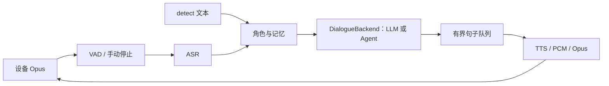

# 语音服务与 Agent 接口

本模块负责设备语音通信、识别、上下文、回复合成和打断。默认后端是 OpenAI 兼容 LLM；启用 MCP 时，现有后端负责摄像头、视觉和设备工具调用。自定义 Agent 的规划、工具调用和工具历史也在 `DialogueBackend` 内处理，继续向语音层输出可朗读文本。

## 上游参考

本次参考 [xiaozhi-esp32-server](https://github.com/xinnan-tech/xiaozhi-esp32-server)。2026-09-22 已取得完整本地源码，现以 `/home/yyy/desktop/ai/xiaozhi-esp32-server` 为核对基准；语音功能与本地测试的剩余差别见 [功能对比](upstream-voice-comparison.md)。

| 上游实现 | 在本服务中的应用 |
| --- | --- |
| `core/handle/textHandler/listenMessageHandler.py` | `mode` 按消息状态处理；停止录音无需携带模式；`detect.text` 可直接发起对话 |
| `core/providers/llm/base.py`、`core/providers/intent/base.py` | 模型与业务决策放在可替换的后端边界内 |
| `core/connection.py`、`core/providers/tts/base.py` | 对话输出和 TTS 使用独立任务及句子队列衔接 |
| `core/utils/dialogue.py` | 系统角色提示与历史记忆分开构造 |

以上是参考设计后的本地实现，不是整个上游服务的替换或依赖，也没有复制它的管理后台、工具插件系统或多供应商实现。

## 数据流



输入音频固定 16 kHz、单声道、60 ms Opus；输出为 24 kHz、单声道、60 ms Opus。每连接拥有独立会话、codec 和 VAD；后端可以被多个会话共享。

## 后端契约

接口定义在 `src/voice_server/dialogue.py`：

```python
def stream(request: TurnRequest) -> AsyncIterator[str]: ...
```

`TurnRequest` 提供：

- `device_id`：跨连接的设备身份，可用于选择 Agent 的持久会话。
- `session_id`：当前 WebSocket 连接的会话身份。
- `turn_id`：当前轮次标识，用于日志、任务关联和取消。
- `text`：本轮识别结果或直接输入的文本。
- `messages`：系统角色、记忆摘要、近期上下文和当前用户消息；当前消息只追加一次。
- `device_mcp`：当前连接的设备工具通道，可为空。
- `diagnostics`：本轮共享的诊断字典，后端可写入工具耗时与结果状态。

后端逐块产出可朗读文本。工具参数、工具结果消息和框架内部事件由后端自己处理，最终选择需要说给用户的内容输出。当前契约不承诺通用工具调用协议。

现有 MCP 后端在允许工具的模型轮次暂存文本：若有调用，执行前文字不会播出或写回为执行事实，后续依据工具结果回答；工具失败由代码直接播报真实原因。若最终没有调用，轮次结束后输出暂存文本，因此工具可用的普通问答也会等待整轮文字。没有可用工具的问答仍逐块输出。直接运动／摄像头命令保留先执行再确认的路径；运动布尔成功表示设备收到指令。

当设备中断或断开时，语音层取消本轮任务并关闭文本迭代器。后端应传播 `asyncio.CancelledError`，在 `finally` 中清理本轮资源。如果 Agent 在远程独立运行，还需由适配器将取消传给其 API；取消本地迭代器不能自动撤回已完成的工具操作。

显式中断先令旧回合失效，在等待 Provider 清理前发送停止播放；会话交接仍等待资源回收，避免突破共享模型并发上限。实际扬声器队列清空由设备处理，服务端停止报文不等同于已测得实机停音。

`tts.start` 携带可选的 `turn_id`，用于关联服务端轮次和设备时钟事件，原有二进制音频不变。设备侧事件与离线日志汇总见 [设备计时说明](../../../docs/voice-device-timing-and-acceptance-2026-11-04.md)。

共享后端应将轮次状态放在局部变量或按设备/轮次隔离。应用停止时，如果注入对象实现了 `close()`，应用会调用它。LLM 配置仍用于本地记忆摘要，注入 Agent 不会禁用摘要服务。

## 最小接入示例

下面的后端可以直接用于验证接入，之后将 `stream` 方法内的回显替换为实际 Agent 调用：

```python
import asyncio
from pathlib import Path

from voice_server.app import ServerApplication
from voice_server.config import load_config
from voice_server.dialogue import TurnRequest
from voice_server.__main__ import run_application


class MyAgentBackend:
    async def stream(self, request: TurnRequest):
        yield f"收到你的请求：{request.text}。"


config = load_config(Path("config.yaml"))
app = ServerApplication.from_config(config, dialogue_backend=MyAgentBackend())
asyncio.run(run_application(app))
```

运行前仍需按 README 准备语音模型、Opus、FFmpeg 和配置。CLI 在 `mcp.enabled=false` 时使用 `LLMDialogueBackend`，开启后使用 `CameraMcpDialogueBackend` 连接本地测试页摄像头工具，并可通过独立视觉模型分析照片。自定义后端通过上述 Python 启动入口注入，优先于配置中的 MCP 后端，不需要修改 WebSocket、ASR 或 TTS 代码。

测试中的 `tests/session/test_dialogue_backend.py` 使用模拟 Agent 验证身份传递、上下文、语音输出、并行接收和取消，不需要实际 Agent 框架。

如果希望 Agent 自己处理点歌，将 `music.enabled` 设为 `false`；开启时，内置点歌分支会先处理匹配到的请求。

## 配置与上下文

```yaml
dialogue:
  system_prompt: 你是小桌，使用简洁、自然的中文口语回答。
  sentence_max_chars: 100
  sentence_queue_size: 2
  first_clause_chars: 18
memory:
  recent_limit: 10
  summary_threshold: 12
  context_limit: 64
  context_max_chars: 8000
  facts_max_chars: 900
  facts_limit: 20
  idle_delay_s: 20
```

系统角色、记忆摘要、当前有效事实与相关历史合并为一条系统消息；近期用户的明确更正优先。首段达到 `first_clause_chars` 后可在逗号等短语边界开始合成，0 可关闭；长文本到达 `sentence_max_chars` 后，即使没有句号也会分段。队列满时暂停接收更多文本，队列等待不消耗 `llm.timeout_s` 的文本生成等待预算；注入 Agent 时同样使用该预算，可按任务耗时调整。

对话上下文包含近期消息、摘要、当前事实和按词面匹配排序的相关历史，历史检索排除已进入近期上下文的消息。上下文同时受 `context_limit` 条数和 `context_max_chars` 字符预算限制；事实另受 `facts_limit` 与 `facts_max_chars` 限制。

普通对话空闲达到 `idle_delay_s`，且新增消息达到 `summary_threshold` 后，后台一次生成摘要和事实，再推进整理进度；新活动取消后台整理。明确“记住／忘掉”命令当轮保存后再确认。SQLite 默认每设备保留 5000 条原始消息，事实跨原文滚动清理保留。被打断的回复只保存已发送的内容，并标明部分发送与中断状态。

管理 API 的 `limit` 仍只控制最近消息条数，与对话上下文的扩展窗口分开。

## 验证与后续改进

```bash
.venv/bin/python -m pytest -q
node --test tests/browser/local_test.test.cjs
```

测试覆盖实际设备停止报文、本地 WebSocket 和 Opus 编解码、记忆持久化与设备隔离、Agent 接入和取消、点歌、转码进程回收。普通测试使用模拟模型，不验证识别准确率、云服务可用性和真机播放效果。

根目录 `Repository checks` 工作流在 PR 和 main push 中运行以上两组离线测试，安装 `requirements-test.txt`、libopus 和 FFmpeg，不下载模型。合并保护需要在仓库设置中单独配置。

现有 Edge TTS 将压缩音频流持续送入 FFmpeg 并输出 PCM；合成预取与按节奏发送并行。ASR 仍在一轮录音结束后识别。`scripts/benchmark_voice_server.py` 已覆盖隔离实例中的真实 WebSocket 链路，输出首文字、首句、首 PCM、首音频与资源指标，设备首声和自然插话仍需实机测量。

下一阶段的实施顺序见 [改进计划](../../../docs/voice-next-improvements-plan-2026-11-02.md)：

1. 工具执行结果与语音播报顺序。
2. TTS 等待与 LLM 首文字长尾的测量和优化。
3. 取消控制、实机 AEC／自然插话，以及设备首声与停音测量。

当前 SenseVoice 的同步推理取消仍需等待模型线程退出，以保持共享模型的并发上限。需要更快打断时，应单独改造推理任务管理，不靠增加轮询解决。
